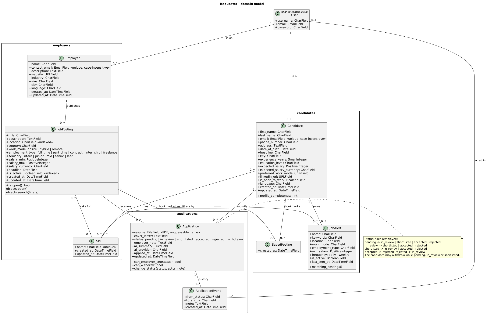
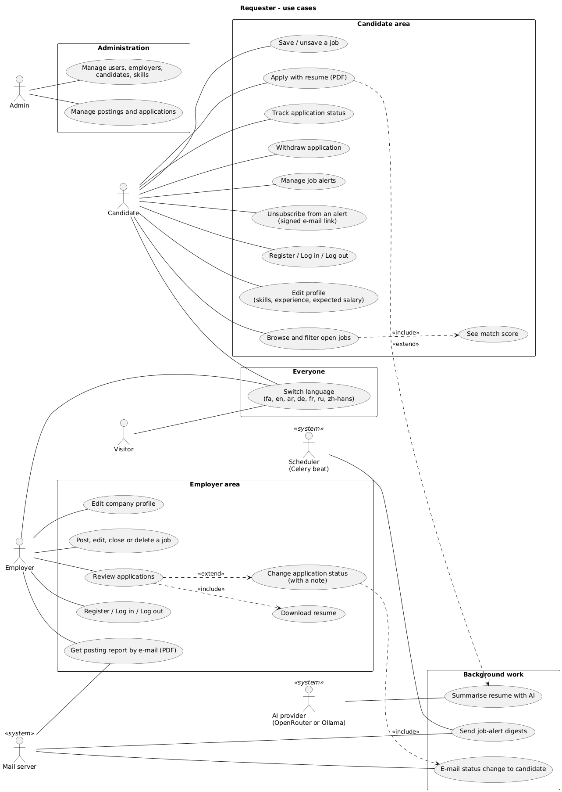
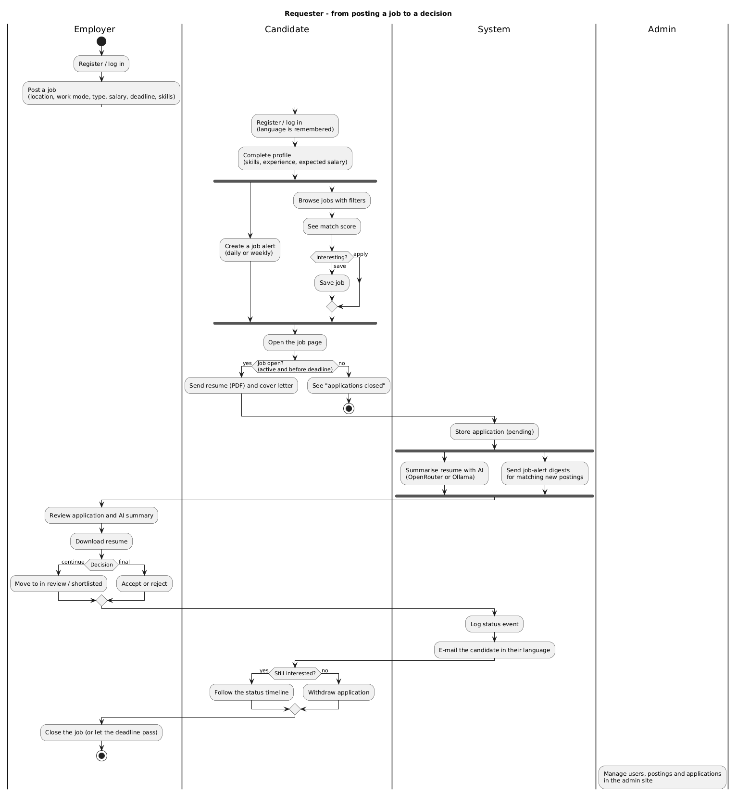

# Requester

Requester is a job platform built with Django. **Candidates** find jobs, apply with a PDF resume and follow every application. **Employers** post jobs, review applications and move them through a hiring pipeline. The interface speaks **7 languages**: Persian (default), English, Arabic, German, French, Russian and Simplified Chinese.

## Features

**Candidates** (`/candidates/`)

- Browse open jobs with filters (city, work mode, employment type, seniority, minimum salary, skills, remote only) and sorting (newest, highest salary, closing soon).
- A **match score** (0-100) compares each job with the candidate's skills, preferred work mode and expected salary.
- Save jobs for later, apply with a PDF resume and cover letter, **withdraw** an application, and see the **status timeline** of each application.
- A full profile: headline, city, skills, experience, education, expected salary, work-mode preference, LinkedIn, language; a completeness bar on the dashboard.
- **Job alerts**: saved searches that e-mail a daily or weekly digest of new matching jobs, in the candidate's language, with a signed one-click unsubscribe link.

**Employers** (`/employers/`)

- Post jobs with location, work mode, employment type, seniority, salary range and currency, deadline and skills; close, reopen, edit or delete them.
- Review applications (search and status filter), download resumes, read an **AI summary** of each resume, and change the status with an optional note. Allowed changes follow fixed rules and every change is logged and e-mailed to the candidate.
- Request a PDF report of all applications for a job by e-mail, in the employer's language.

**AI resume summaries** use [OpenRouter](https://openrouter.ai): on when `OPENROUTER_API_KEY` is set, skipped otherwise. See [AI summaries](#ai-summaries).

## Names

The project was renamed so that the code says what things are:

| Before | Now |
|---|---|
| app `offer`, model `Offer` | app `employers`, model `Employer` |
| `Job`, `Tag` | `JobPosting`, `Skill` (in `employers`) |
| app `worker`, model `Worker` | app `candidates`, model `Candidate` |
| `JobRequest` | `Application` (app `applications`, with `ApplicationEvent` for the status history) |
| app `requester_handler` | merged into `applications` (`tasks.py`, `ai.py`) |
| `/offer/…`, `/worker/…` | `/employers/…`, `/candidates/…` (old URLs redirect permanently) |
| compose services `web, celery, ollama, elasticsearch, mailserver, mariadb, redis` | `web, tasks, scheduler, search, mailhog, db, cache` (the local Ollama service was removed) |

### Upgrading an existing database

`make dev` and `make deploy` run `manage.py migrate` and then `manage.py import_legacy_data`. It copies the rows of the old `offer_*` / `worker_*` tables into the new ones, keeping IDs and timestamps (so uploaded resumes still match), does nothing on a fresh database and nothing the second time. The old tables are left in place as a backup; drop them when you are satisfied.

## Diagrams

The PlantUML sources are in `diagram/`; `make diagrams` redraws the PNGs (PlantUML runs in Docker).

| Class diagram | Use cases |
|---|---|
|  |  |

## Languages

Persian is the default. A visitor picks a language with the dropdown at the top of every page (stored in a cookie, no language in the URL); otherwise the browser's language is used. Persian and Arabic render right-to-left, the others left-to-right, from the same stylesheet (CSS logical properties). Persian pages use the Jalali calendar, the other languages the Gregorian one. Candidates and employers also have a preferred language that is used for e-mails and reports.

- Messages live in `src/locale/<language>/LC_MESSAGES/django.po` (`zh-hans` is the folder `zh_Hans`). The source language of the code is English.
- After changing text in a template or Python file run `make i18n` (extracts into every `.po`; runs in Docker because it needs GNU gettext), translate the new empty entries, then `make i18n-check` (fails on missing, fuzzy or placeholder-breaking translations).
- `.mo` files are not committed. `make dev` builds them with a pure-Python script (`make i18n-compile`); the Docker services run Django's `compilemessages`.

## AI summaries

Resume summaries run in the background (Celery) in the employer's language, through OpenRouter only:

- `OPENROUTER_API_KEY` set: summaries are on.
- No key: the feature is skipped silently (applications work as usual, no summary is shown).

Settings: `OPENROUTER_API_KEY`, `OPENROUTER_MODEL` (default `google/gemma-3-4b-it`, a very light multilingual model; any OpenRouter model id works), `AI_TIMEOUT_SECONDS`, `AI_MAX_INPUT_CHARS` (resume text is cut to this length, default 12000). The key is read from the environment only and is never logged or shown. **Privacy:** the text of uploaded resumes is sent to OpenRouter and the model provider behind it.

## Required tools

- **Python 3.12** and **uv** (`uv sync` installs everything from `pyproject.toml` / `uv.lock`)
- **Docker** and Docker Compose for the full stack, translations extraction and diagrams
- Services in the stack: **MariaDB** (`db`), **Redis** (`cache`, Celery broker), **Elasticsearch 9** (`search`), **MailHog** (`mailhog`), **Celery** worker (`tasks`) and beat (`scheduler`)

## Makefile commands

- `make dev` - run the dev server on SQLite (no Docker); migrates, imports legacy data, builds translations
- `make seed` - fill the dev database with demo employers, jobs, candidates and applications (accounts use the password `password123`; refused unless debug is on)
- `make fix` - format, lint, type check, test and run Django checks
- `make i18n` / `make i18n-compile` / `make i18n-check` - translations (see above)
- `make diagrams` - redraw `diagram/*.png`
- `make docker-up` - start the dev stack (`docker-compose.yaml` + `docker-compose.dev.yaml`)
- `make test-mariadb` - run the tests against a real MariaDB started from compose
- `make help` - list every command

## Docker: development and production

Copy `.env.example` to `.env` to set secrets; nothing secret is written in the compose files.

`docker-compose.dev.yaml` is a development override (`make docker-up` uses it): `DJANGO_DEBUG` on, the Django dev server, demo data and an admin login `admin` / `admin`. Never use it for a real deployment.

`docker compose up -d --build` with only `docker-compose.yaml` is production-like:

- `DJANGO_DEBUG` is off, so Django refuses to start unless `SECRET_KEY` is set.
- `ALLOWED_HOSTS` defaults to `localhost,127.0.0.1`; set it to your domain. Set `SITE_URL` to the public address (it is used for links in e-mails).
- It runs gunicorn after `collectstatic`; no demo data is created.
- An admin user is created only if `DJANGO_SUPERUSER_PASSWORD` is set. An existing admin's password is never reset.
- Session and CSRF cookies are `Secure` when debug is off: serve the site over HTTPS (set `BEHIND_PROXY=true` behind a TLS proxy), or set `SECURE_COOKIES=false` for a plain-HTTP test.
- Database passwords come from `DB_PASSWORD`, `DB_ROOT_PASSWORD` and `REDIS_PASSWORD`; the defaults are for local development only.

Database settings are `DB_NAME`, `DB_USER`, `DB_PASSWORD`, `DB_HOST`, `DB_PORT` (MariaDB). Without `DB_NAME`, the app uses SQLite.

### Elasticsearch 9

The stack uses Elasticsearch **9.5.1** with `django-elasticsearch-dsl` 9 / client 9. The indices (`job_postings`, `applications`) are only a synced copy of database data: if you start from an `es_data` folder created by Elasticsearch 8, delete it (`make docker-clean` removes all data folders) and let `make deploy` rebuild the indices (`search_index --rebuild`). Elasticsearch 9 can only upgrade data from 8.19, so rebuilding is simpler than upgrading in place.
